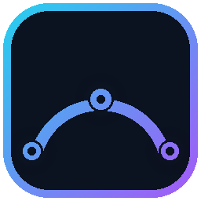
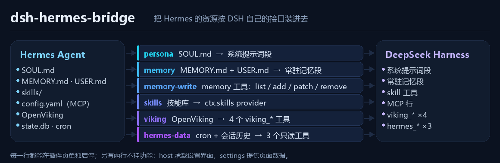

<div align="center">
  

# dsh-hermes-bridge

[简体中文](README.md) ｜ **English**


<br>

> Bring [Hermes Agent](https://hermes-agent.nousresearch.com/docs)'s **persona, long-term memory,
> skill library, MCP servers and OpenViking knowledge base** into DeepSeek Harness (DSH) natively —
> so the agent living in DSH and the one living in Hermes share one personality and one memory.
>
> Every bridged capability is a separate row you can switch off on its own, and a visual settings
> page takes care of first-run setup: probe the path, save it, fill in the OpenViking identity,
> sync MCP in one click. No terminal required.
>
> This is not "a tool that calls Hermes" — it installs the resources through DSH's own interfaces:
> persona and memory become `ctx.systemPrompt` sections, skills become a `ctx.skills` provider
> (reusing DSH's built-in `skill` tool), MCP becomes DSH's own `dsh-mcp-client` rows, and OpenViking
> registers through `ctx.tools`. The model sees one set of tools, not two layers.

</div>



---

## Highlights

- **Bridging, not wrapping** — memory is a native DSH system-prompt section, skills are a real `ctx.skills` provider, tools register through `ctx.tools`. No middle layer.
- **Nine rows, each one switchable** — every capability is its own row, so it can be turned off from the Plugins page or from this plugin's settings page, and a broken one only affects itself.
- **Mounting never throws** — a missing Hermes install, a stopped OpenViking server or a wrong path only affects the row that needs it and surfaces a clear error at call time instead of taking the profile down.
- **Five settings pages** — Overview, Connection, Skills, Preview, Diagnostics. Switches write back to the profile's own `cordis.patch.yml`; your comments and hand-written rows survive byte for byte.
- **Memory entries carry their origin** — both sides write `MEMORY.md` / `USER.md`, so new entries are tagged `[dsh]` / `[hermes]` and you can always tell who wrote what.
- **No retro-tagging** — `MEMORY.md` is a hard character budget; prefixing historical entries would eat the space the other side needs to write. Only new entries get a tag.
- **No config writes at boot** — writing your own config during startup makes the harness reload itself mid-start, the classic recipe for "worked once" bugs.
- **Read-only on purpose** — cron and session history are read-only: two schedulers sharing one jobs file only produce duplicate or never-firing jobs.
- **Tested, with probes** — 91 tests (57 offline, runnable anywhere; 20 live against a real Hermes home; 14 rendered-pixel checks on the plugin icon) plus a composition-tree probe.

## What gets bridged

| Row | Module | What it does | How it reaches the model |
|---|---|---|---|
| `hermes-bridge-host` | `dsh-hermes-bridge` | Carries the browser half (settings UI); mounts no feature itself | — |
| `hermes-bridge-persona` | `dsh-hermes-bridge/persona` | Hermes' `SOUL.md` → a system-prompt section (order 5) | always |
| `hermes-bridge-memory` | `dsh-hermes-bridge/memory` | `MEMORY.md` + `USER.md` (order 6, re-read every assembly), tagged by origin | always |
| `hermes-bridge-memory-write` | `dsh-hermes-bridge/memory-write` | a `memory` tool: list / add / patch / remove | on demand |
| `hermes-bridge-skills` | `dsh-hermes-bridge/skills` | recursively discovers Hermes' `skills/` and registers a `ctx.skills` provider | on demand |
| `hermes-bridge-viking` | `dsh-hermes-bridge/viking` | four OpenViking tools (search / read / browse / remember), hand-written HTTP client | on demand |
| `hermes-bridge-provider` | `dsh-hermes-bridge/provider` | **generic**: mounts whatever memory backend Hermes is configured to use (openviking / retaindb / byterover / honcho / mem0 / hindsight / supermemory …) | on demand |
| `hermes-bridge-updater` | `dsh-hermes-bridge/updater` | checks GitHub for a newer version on a schedule, optionally installs it, then tries a hot reload | — |
| `hermes-bridge-mcp` | `dsh-hermes-bridge/mcp` | reconciles Hermes' MCP servers with the rows already mounted and reports drift | row level |
| `hermes-bridge-hermes-data` | `dsh-hermes-bridge/hermes-data` | Hermes' cron list + session history search (**read-only**) | on demand |
| `hermes-bridge-settings` | `dsh-hermes-bridge/settings` | data backend for the settings page (not a feature) | — |

## Install

Prerequisites: DSH desktop installed, and Hermes Agent already initialized (this plugin bridges Hermes, it does not install it).

In DSH: **Plugins → Add plugin → Install third-party plugin**, and give the repository address. Or use the CLI, which appends the package to that profile's `dsh.profile.bundles` automatically (verified end to end):

```bash
dsh plugin --profile <profile> add github:Loki-kiki/dsh-hermes-bridge
# or, for local development, an absolute path
dsh plugin --profile <profile> add <absolute path to this repo>
```

Restart DSH afterwards.

> If pnpm fails with `ERR_PNPM_NO_MATCHING_VERSION`, check which package it names — it is usually a version declaration of some *other* plugin in that profile. A link install (profile `package.json` entry `"dsh-hermes-bridge": "link:<path>"` plus a `node_modules` junction) sidesteps that.
>
> `node_modules/yaml` is a runtime dependency; a link install resolves it from this directory, so don't delete it.
>
> A `schannel: ... CRYPT_E_REVOCATION_OFFLINE` error while pnpm resolves the git dependency is a local git/TLS issue (Windows schannel cannot fetch the revocation list) — `git config --global http.sslBackend openssl` fixes it.

## First run

**Settings → Hermes Bridge → Connection** is written for first-time installers:

1. The plugin probes for the Hermes home itself: `$HERMES_HOME` → Windows `%LOCALAPPDATA%\hermes` → `~/.hermes`. If it cannot find one, a red callout appears at the top of the page — type the path, hit **Test**, then **Save**. Saving validates that the directory exists before writing anything, so a typo never lands in your config.
2. Set `account` / `user` / `agent` if you use OpenViking. `user` is your OpenViking tenant name and must match Hermes' `memory.openviking.user`. Leaving it empty means "not configured": the `viking_*` tools then say exactly which setting is missing instead of reading or writing someone else's tree.
3. If Hermes has MCP servers configured, hit **Sync now** to generate native DSH rows (restart DSH to apply). The sync writes a managed block — your other hand-written rows are untouched, and re-running it is idempotent.

Every write goes to the profile's `cordis.patch.yml` overlay (written through a `yaml` Document so comments survive, then atomically renamed), and row switches hot-reload via `dsh-hmr` — no restart needed.

## Settings page

Five tabs:

| Tab | Contents |
|---|---|
| Overview | switches for the nine feature rows, memory origin distribution, every file the bridge actually reads (real size + mtime), Hermes-side memory settings, live OpenViking health |
| Connection | the first-run guide: Hermes probe, path input/test/save, OpenViking endpoint and identity, **plugin-update panel**, **memory-provider panel** (backend / agent tree / interpreter / one-click tool probe), one-click MCP sync |
| Skills | per-skill switches with search, category filter and bulk toggle — effective on the next conversation |
| Preview | the persona and memory sections **as actually injected**, rendered from the files rather than guessed from config |
| Diagnostics | profile, both homes, overlay path, skill state file — each one copyable in a click |

The **memory origin** bar on the Overview page states how many entries `MEMORY.md` / `USER.md` hold, who wrote them and how much budget is used (e.g. `34 entries · 3492/3500`). The numbers are re-read from disk every time, not cached.

**Row switches** write back to the profile's own `cordis.patch.yml`. **Skill switches** are not row switches: they go to `<profile>/hermes-bridge-skills.json`, and the skill provider re-reads the list on every `list()` and calls the registration handle's `invalidate()` to drop its directory cache.

## Memory origin tags

The `memory` row only reads; the `memory-write` row writes. Both sides write the same files, so "who wrote this one" has to be visible:

```
[hermes] written by Hermes itself after tagging started
[dsh]    written from the DSH side
(no prefix) written before tagging; read back as [hermes?] — an inference, not a fact in the file
```

**No retro-tagging**: `MEMORY.md` is a hard character budget, and prefixing historical entries would blow up the space the other side writes into. Old entries stay exactly as they are; only new ones carry a prefix.

The write origin is locked to `dsh`. The model cannot ask for `hermes` — that would let it pass its own words off as another agent's. Set `allowOriginOverride: true` explicitly to open that up.

## Configuration

Every row accepts a `hermesHome` override and otherwise resolves Hermes' own rules (`$HERMES_HOME` → Windows `%LOCALAPPDATA%\hermes` → `~/.hermes`). Unknown keys are rejected loudly, with the list of acceptable ones, instead of being silently ignored.

```yaml
- id: hermes-bridge-persona
  config:
    file: SOUL.md          # relative to hermesHome
    extraFiles: []         # extra files appended to the persona section
    order: 5               # system-prompt section order
    maxBytes: 32768
    header:                # custom section preamble

- id: hermes-bridge-memory
  config:
    dir: memories
    files: [MEMORY.md, USER.md]
    order: 6
    maxBytes: 32768
    withLabels: true       # "Agent notes" / "About the user" labels per section
    watch: true            # re-read after the files change

- id: hermes-bridge-memory-write
  config:
    origin: dsh            # origin tag for new entries
    allowOriginOverride: false
    readOnly: false

- id: hermes-bridge-skills
  config:
    dir: skills
    providerName: hermes   # must not be `runtime` (reserved registry name)
    rank: 350              # priority against DSH's own providers
    maxDepth: 4
    includePrefix: []      # only these category prefixes, e.g. [devops, productivity]
    excludePrefix: ['.', '_']
    maxSkills: 1000
    descriptionMaxChars: 900
    stateFile:             # empty = derived from the profile

- id: hermes-bridge-viking
  config:
    endpoint: http://127.0.0.1:1933
    account: default
    user: ''               # your tenant name; empty = not configured, tools will say so
    agent: hermes
    apiKey:                # only needed if the server enables auth
    timeoutMs: 30000
    recallLimit: 10
    scoreThreshold: 0.3
    enableRead: true       # viking_read
    enableBrowse: true     # viking_browse
    enableRemember: true   # viking_remember

- id: hermes-bridge-mcp
  config:
    warnOnDrift: true
    toolCallTimeoutMs: 180000
    # usually omit profile: profileContext wins at runtime

- id: hermes-bridge-hermes-data
  config: {}               # only hermesHome
```

## CLI

```bash
# health check: Hermes files, persona/memory byte counts, skill discovery, MCP roster
dsh-hermes-bridge doctor [--json] [--profile desktop]

# generate MCP rows from Hermes' config.yaml into the profile's cordis.patch.yml
dsh-hermes-bridge mcp sync --profile <name> [--dry-run] [--timeout <ms>]

# roll back (removes the managed block, leaves everything else untouched)
dsh-hermes-bridge mcp clear --profile <name> [--dry-run]

# list skills
dsh-hermes-bridge skills [list] [--json] [--limit 200]

# print the byte counts and file status of what will be injected as memory
dsh-hermes-bridge memory

# probe the memory provider Hermes is configured to use
dsh-hermes-bridge provider [--provider <name>] [--json]
```

Global options: `--hermes-home <path>`; environment: `HERMES_HOME`, `DSH_HOME`.

## Turning a row off

Any of the three:

1. the switch next to that row on the settings page or the Plugins page
2. add this to the profile's `cordis.patch.yml`:
   ```yaml
   - id: hermes-bridge-skills
     disabled: true
   ```
3. change the default inside this package's `cordis.patch.yml` (overwritten on upgrade — for temporary experiments only)

Do not disable `hermes-bridge-host`, and do not move features into it: DSH binds the browser half to the row whose **specifier is the bare package name** (`exactPackageSpecifier()` returns `undefined` for subpaths), so without it the settings UI silently disappears — and any feature you mount on that row can never be switched off again.

## Updating itself (`updater` row)

This package asks GitHub whether a newer version exists, and installs it into the current profile when you click the button.

### How it decides there is a new version

It reads `version` from the `package.json` in the repository and compares it with **the copy that is actually running**:

- "Actually running" is *not* read from config — it resolves `package.json` upwards from the module's own location. The package may be `link:`ed to a working copy or installed into pnpm's virtual store; only the module knows which code is executing.
- Version comparison is hand-written (`<major>.<minor>.<patch>` plus a prerelease segment) rather than pulling in `semver`. One more runtime dependency is one more thing that can fail to install.
- It reads `raw.githubusercontent.com` instead of the GitHub API: the anonymous API is limited to 60 requests/hour/IP, which a 6-hourly check eventually hits; raw has no such limit and serves the real file from the repo. `ETag` is used, so a 304 costs no transfer.

### First, a trap: the npm package with this name is someone else's

`dsh-hermes-bridge` on npm belongs to another person (`xiaoyu7044`'s
`dual-agent-integration`, still publishing in Oct 2026). This package lives on
GitHub only — it was **never published to a registry**.

The consequence: updating "by version number from the registry" installs someone
else's code, and it *succeeds*, with a version number bigger than ours. It looks
exactly like a normal update. So updates follow only how your copy is installed:

| Dependency | Updateable |
|---|---|
| `github:Loki-kiki/dsh-hermes-bridge` | ✅ reinstalls from the same source, newest commit |
| `link:...` | ❌ tells you to update that directory with git |
| `file:...` | ❌ tells you to edit that directory |
| `^0.4.1` (semver, from a registry) | ❌ **refused**, with an explanation that the package is not ours |

The panel lists the install source separately. If this copy did not come from the
repository, a bigger GitHub version shows an explanation and no update button —
better to not update than to install the wrong thing.

### How it installs

Through pnpm — the same package manager the Plugins page uses. It does not download and overwrite files, so "updated" and "freshly installed" end up byte-identical instead of being two different things that cannot reproduce each other's bugs.

**But "the same pnpm" has to be found first.** The desktop app does not have pnpm
on `PATH`: it runs its bundled copy through Electron itself
(`resources/runtime/primary-runtime/dependencies/pnpm/bin/pnpm.mjs`). A bare
`spawn('pnpm')` from a plugin gets "not recognized as an internal or external
command" — not because the environment is broken, but because the entry point is
wrong. Resolution order:

1. `pnpm:` in the row config (when you name one explicitly)
2. the DSH-bundled copy (derived from `process.execPath`) ← the desktop case
3. `pnpm` on `PATH` (self-hosted `dsh web`, or a global install)

Each candidate is actually invoked with `--version` rather than checked for
existence: a file that exists but cannot run is more common than a missing one,
and that failure points inside pnpm instead of at the wrong entry point. The
resolved copy is recorded with the install result, so a failure shows which one
was used.

What it installs depends on **how your copy was installed**:

| Your dependency | Behaviour |
|---|---|
| `^0.2.0` (npm / registry) | `pnpm add <name>@<new version>` |
| `github:...` / `git+...` | reinstalls from the same source, picking up the latest commit |
| `link:E:/...` (a working copy) | **leaves it alone** and tells you to update that directory with git |

That last row is deliberate: running `pnpm add name@version` on a `link:` dependency replaces the link with a registry copy — silently destroying a developer's edit loop while looking like a successful update.

### "Installed" and "in effect" are different answers

After installing it asks DSH's own HMR to replace the modules live. Three outcomes, reported separately:

```
Hot-reloaded — the new code is running now.          ← best case
Installed, but this one needs a DSH restart: <why>    ← common
Install failed: <pnpm's real error>                   ← sometimes
```

**Why they must not be merged**: HMR depends on the ESM module cache, which a packed worker does not keep; there it can only return `restart-required`. Reporting that as "updated" means every later "I'm on the latest version" judgement is wrong, with no way to notice.

### A failed check is not an error

GitHub is often slow or unreachable from mainland China. Checking is bounded by a timeout, cached, and a failure is recorded as "currently unknown" — the page keeps working instead of showing a spinner that never resolves.

### Configuration

```yaml
- id: hermes-bridge-updater
  name: dsh-hermes-bridge/updater
  config:
    repo: Loki-kiki/dsh-hermes-bridge   # point at your fork as owner/name
    branch: main
    intervalHours: 6                    # minimum 1 minute
    autoCheck: true                     # reads one JSON
    autoInstall: false                  # installing replaces running code; leave it to a human
    timeoutMs: 20000
    # pnpm: ''        # empty = autodetect (the DSH-bundled copy wins)
```

`autoInstall: true` is for unattended setups. Day to day, `false` is safer: an automatic install that lands while you are waiting on a long answer swaps the code out mid-flight.

## The generic memory provider (`provider` row)

The `viking` row is a hand-written OpenViking client — one backend, by design. Hermes has far more: `retaindb` and `byterover` ship in-tree, and the plugin catalog carries dozens more (honcho, mem0, hindsight, supermemory, lancedb, cognee…), with new ones arriving regularly.

Re-implementing each one's REST/CLI client in JavaScript is a losing race: every new backend, endpoint change and schema tweak needs a matching JS edit, and any drift shows up as a tool that **silently returns the wrong thing** instead of erroring.

So the `provider` row goes the other way — **Hermes' own loader is the adapter**:

```
DSH  ──tool call──▶  lib/py/provider_bridge.py  ──▶  Hermes' MemoryProvider
     ◀──JSON─────                       (plugins.memory.load_memory_provider)
```

The worker does three things: read Hermes' `memory.provider`, take that provider's `get_tool_schemas()`, forward calls to `handle_tool_call()`. Consequences:

- **No drift** — an endpoint change lands in Hermes only; the bridge follows.
- **No per-provider work** — install honcho in Hermes and its tools appear here.
- **Same tool names** — the model sees the names Hermes uses, so habits transfer.

### Do the two rows collide?

Yes, when the configured provider *is* OpenViking: both want to register `viking_*`. A duplicate tool name is a **hard error in DSH, not a merge** (`tool "x" is already registered`), so:

- the `viking` row claims the names first (it is earlier in the patch);
- the `provider` row skips claimed names and reports how many it left alone;
- to get the provider's own schemas (e.g. `viking_search` with its `mode` argument), turn the `viking` row off.

The `provider` row **ships disabled**: it costs a Python process (Hermes' venv + agent tree), and OpenViking users already have the hand-written row. Switch it on to use another backend, or to standardise on Hermes' own implementation.

### Which Python, which agent tree

Both derive from `hermesHome`: `<hermesHome>/hermes-agent` and the venv inside it. If Hermes lives elsewhere, or uses a different interpreter:

```yaml
- id: hermes-bridge-provider
  name: dsh-hermes-bridge/provider
  config:
    agentRoot: D:/tools/hermes/hermes-agent
    python: D:/tools/hermes/hermes-agent/venv/Scripts/python.exe
    provider: ''      # empty = follow Hermes' memory.provider
```

The defaults are deliberate: **a first-time user should not have to edit config to get it working**.

### Checking it yourself

```bash
dsh-hermes-bridge provider                        # human: which backend, ready?, which tools
dsh-hermes-bridge provider --json                 # for scripts
dsh-hermes-bridge provider --provider retaindb    # try a backend Hermes is not using
```

Exit code `0` only when the backend is *available*; `ok` merely means the worker answered, `available` means it can serve calls — keep those apart.

## Two kinds of memory are not the same thing

| | Built-in memory (`memory` row) | OpenViking (`viking` row) |
|---|---|---|
| Storage | `MEMORY.md` / `USER.md`, plain text | vector store + layered context (L0/L1/L2) |
| Reaches the model | injected whole on every request | only when the model calls `viking_search` |
| Written by | the memory tool | automatic extraction + `viking_remember` |
| Idle cost | fixed tokens | zero |

OpenViking only really participates when Hermes has `memory.provider: openviking` and the provider plugin is not blocked by `plugins.disabled`. Verify with `test/viking-probe.mjs` afterwards instead of trusting a feeling.

## Design notes

- **Why auto-install ships off**: updating replaces modules that are currently running. Default-on would mean code being swapped out at some moment when you are waiting for an answer. Checking is read-only, so it ships on.
- **Why updates go through pnpm rather than a download**: two install paths produce two artefacts. Updating and first-installing must share one path, otherwise "people who updated" and "people who just installed" run different things and cannot reproduce each other's bugs.
- **Why a failed hot reload is stated plainly**: HMR needs the ESM module cache, which a packed worker does not keep; there it can only return `restart-required`. Calling that "updated" makes every later "I'm current" judgement wrong, invisibly.
- **Why the memory provider is not re-implemented per backend**: Hermes' providers share one Python contract (`get_tool_schemas()` + `handle_tool_call()`), with three in-tree and dozens more in the catalog, still growing. Writing a JS client per backend never catches up, and an endpoint change turns into a tool that silently answers from the wrong route. Letting Hermes' own loader act as the adapter makes new backends work with no bridge change. The cost is one Python child process: started lazily, killed on timeout, shut down when the row unloads.
- **The worker's stdout *is* the protocol**: `provider_bridge.py` dups fd 1 away and then points fd 1 at fd 2. Otherwise any `print` inside a provider (or a native library it loads) corrupts the protocol, which surfaces as "one call failed, the retry worked".

- **Why cron and session history are read-only**: writing to Hermes' cron has to go through its gateway, and two schedulers sharing one `jobs.json` only produce duplicate or never-firing jobs. Read-only answers "are my scheduled jobs still alive?" without switching back to Hermes.
- **Why MCP is not connected from inside the plugin**: DSH mounts one `dsh-mcp-client` row per server, and rows must live in the profile patch to be visible and individually switchable. The plugin only reconciles and generates rows.
- **Why skills needs its own provider**: DSH's built-in `dsh-skill-filesystem` only sees one level (`<root>/<name>/SKILL.md`), and Hermes' skill library is categorically nested — pointing it at the root discovers nothing.
- **Mounting never throws**: a missing Hermes install, a stopped OpenViking server or a wrong path only affects the row that needs it, and surfaces as a clear error at call time.
- **No config writes at boot**: writing your own config during startup makes the harness reload itself mid-start, which is the classic recipe for "worked once" bugs.

## A pitfall for plugin authors

`ctx.tools.register()` takes an **already converted JSON Schema**. The DSL shorthand (`{ type: 'string', required: true }`) is only expanded by `defineTool()`, and a bundle plugin cannot import values from `@deepseek-ai/*` (only the loader provides those names). That is why `lib/schema.js` ships its own equivalent conversion:

```js
import { defineTool } from './schema.js'

tools.push(defineTool({
  name, description,
  parameters: { q: { type: 'string', required: true, description: 'search query' } },
  execute,
}))
```

The error you get without it looks like this:

```
INVALID_REQUEST: Invalid schema for function 'xxx':
schema must be a JSON Schema of 'type: "object"', got 'type: null'
```

Also, every `name: '<pkg>/<subpath>'` appearing in a patch must be declared in `package.json`'s `exports`, or that row silently fails to activate (`ERR_PACKAGE_PATH_NOT_EXPORTED`).

## Development and tests

Install dependencies in the clone first (`yaml` is a runtime dependency; without it `settings`/`splice` fail immediately with `ERR_MODULE_NOT_FOUND`):

```bash
npm install
npm test    # offline tests, runnable on any machine
```

Or run them individually:

```bash
node test/splice.mjs         # managed-block splicing
node test/memory-store.mjs   # memory files (CRLF / concurrency / origin tags / budget)
node test/schema.mjs         # DSL -> JSON Schema conversion
node test/settings.mjs       # settings backend: config writes, probing, row switches, skill list
node test/provider.mjs       # the generic provider row (9 offline; --live adds 11 against a real backend)
node test/updater.mjs        # the updater (version compare / config / network failure / encoding / link: protection)
node test/client-render.mjs  # loads client.js the way the host does and renders every tab

# these read real Hermes data, skipped by default:
npm run test:live   # cron + session db, memory tool end to end, 11 real-provider checks

# OpenViking probe (hits a real server; a tenant name is required):
VIKING_USER=<your-tenant> node test/viking-probe.mjs --endpoint http://127.0.0.1:1933

# composition probe: prove a row really lands in DSH's composed tree
DSH_ASAR_ROOT="<app>/resources/app.asar/dsh/node_modules/@deepseek-ai" \
  ELECTRON_RUN_AS_NODE=1 "<app>/<exe>" test/probe-compose.cjs <profileDir> [rowId]
```

README artwork (the tile icon, the flow diagram, and the bundle icon DSH's plugin page renders) is generated — regenerate after a style change (the script self-checks its own pixels):

```bash
python docs/images/build-diagrams.py
```

`build-diagrams.py` also writes the package-root `icon.svg` — the plugin-page icon. It shares the geometry of the README mark but drops the dark plate and thickens the strokes: DSH paints row artwork at 30px and card artwork at 36px, where a plated tile collapses into a dark blob. Then verify the rendered pixels:

```bash
npm run test:icon    # needs sharp (a devDependency): symmetry / connectivity / hubs / bleed
npm run test:meta    # re-checks DSH's own iconOf() rules: relative / inside package / format / 256 KiB / exports
```

## Plugin-page title, description and icon

DSH's Plugin Manager reads display metadata without activating a plugin (per the `cordis-plugin-development` skill shipped with DSH, `references/host-plugin.md`):

| File | Role |
|---|---|
| `icon.svg` (package root) | the plugin-page icon, pointed at by `package.json`'s `icon` field; SVG/PNG/JPEG/WebP, ≤256 KiB, must stay inside the package |
| `locale/en.json` · `locale/zh.json` | `meta.title` / `meta.description`, shown per interface language |

Both must appear in `package.json`'s `exports` and `files` (`./icon`, `./locale/*.json`), or they are dropped from the tarball. A missing icon falls back to the panel's default artwork; missing locale falls back to the package name and `description`.

> The icon is a transparent 36×36 glyph, not the 256px plated tile used in this README — the plated version turns into a dark brick in a 30px row.

Local development install: junction this directory into `<DSH_HOME>/profiles/<profile>/node_modules/dsh-hermes-bridge`, or use a `link:` dependency in the profile's `package.json`.

## License

MIT
